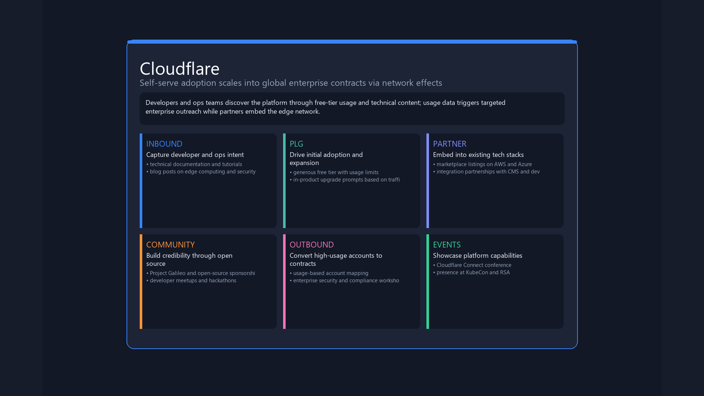
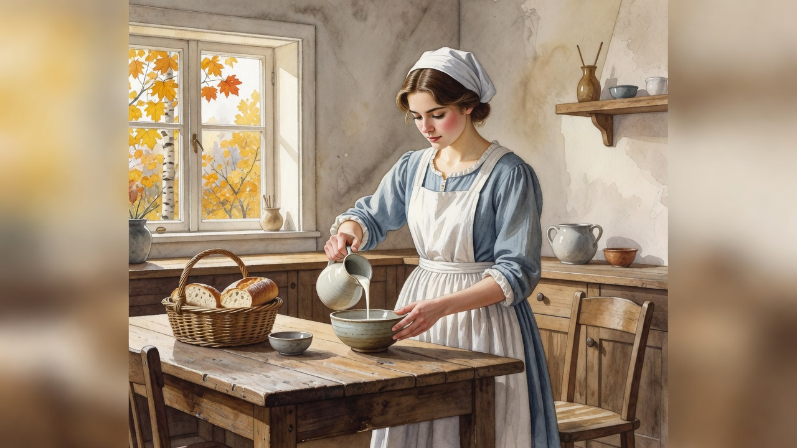

# What this tool does

One Windows desktop wallpaper per **Asia/Kolkata** day. Three themes rotate. **No Bing.**

| Theme | What you get |
|-------|----------------|
| **gtm** | A center-safe company channel map. Grok researches a real company. Pillow draws the card, so the labels stay readable and clear of the desktop icons. |
| **literary** | A book scene. Grok plans it. Grok Imagine paints it in a famous painter’s brushwork and light. The book stays the subject. |
| **painting** | A famous canvas, reimagined. Grok Imagine keeps the pose and setting recognizable. Figures are clothed. |

Rejecting a day sets NASA’s Astronomy Picture of the Day instead. A journal and an xAI cost log stay on the machine with the generated libraries. `Grok_Daily/` and `Curated/` are not in git. The two pictures below are copies for this public repo.

License: **MIT**, named in `pyproject.toml`.

## GTM — Cloudflare

22 October 2026. Six channels on a center card: inbound, product-led growth, partner, community, outbound, and events.

## Painting — The Milkmaid

18 October 2026. Vermeer’s kitchen pour, recast as an autumn watercolor. The figure is clothed. The subject stays the milk, the table, and the window.

